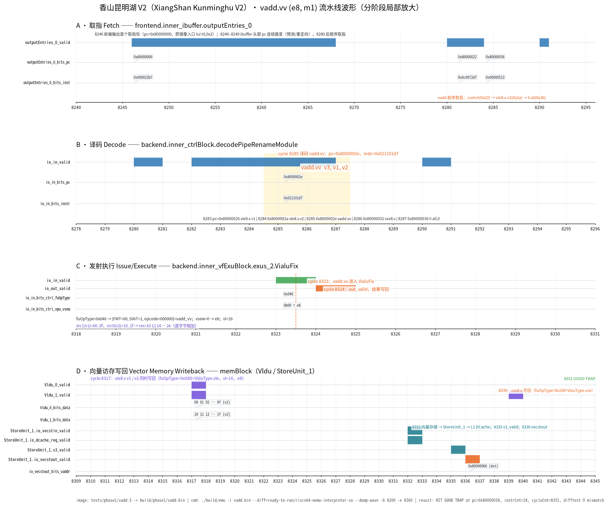

# 阶段一 1.3 · vadd 在香山昆明湖 V2 中的执行过程（依据波形）

> 对应官方要求 **1.3「vadd 指令执行过程文档（依据波形与参考文档）」**。
> 本文所有 cycle 编号、信号值均取自真实 VCD（`/tmp/vadd_wave_r2.vcd`），可由 §2 的命令逐字复现。
>
> | 项 | 值 |
> |---|---|
> | 平台 | 香山昆明湖 V2（`16ae9ddcda54fc9a2fddffad73174cf793ac7814`，2025-04-03），Verilator 5.034 仿真 |
> | 配置 | `--config DefaultConfig --issue E.b --num-cores 1`，`EMU_TRACE=vcd` |
> | 镜像 | `tests/phase1/vadd.S` → `build/phase1/vadd.bin`（112 B，RV64GCV 裸机） |
> | 结果 | `HIT GOOD TRAP at pc = 0x80000038`，`instrCnt = 18`，`cycleCnt = 8,351`，difftest 参考模型全程比对无 mismatch |
> | 波形截图 | [`vadd_pipeline_wave.png`](wave/vadd_pipeline_wave.png)（分阶段局部放大，4 个面板） |



---

## 1. 结论先行

一条 `vadd.vv` 在香山中走完了完整的五段路程，逐 cycle 可核对：

| 阶段 | cycle | 观测点（信号） | 实测值 |
|---|---|---|---|
| 取指 | 8246 起 | `frontend.inner_ibuffer.outputEntries_0_valid/bits_pc/bits_inst` | 8246 `0x80000000 / 0x000022b7` |
| 译码 | **8285** | `backend.inner_ctrlBlock.decodePipeRenameModule.io_in_valid/pc/instr` | `0x8000002e / 0x021101d7`（`vadd.vv v3,v1,v2`） |
| 发射执行 | **8323 → 8324** | `backend.inner_vfExuBlock.exus_2.VialuFix.io_in_valid / io_out_valid` | 入 `fuOpType=0x040`、`vsew=0b00`；出一拍后 `res=0x2e2c…10` |
| 访存（加载） | 8317 | `memBlock.io_mem_to_ooo_writebackVldu_0/1_valid` | `v1=00..0f`、`v2=10..1f` 同时写回，`fuOpType=0x080`（`VlduType.vle`），`vl=16` |
| 访存（存储） | 8332 → 8336 | `memBlock.inner_StoreUnit_1.io_vecstin/dcache_req/s3_valid/io_vecstout` | `vecstin` 8332、`dcache_req` 8332、`s3_valid` 8335、`vecstout` 8336，地址 `0x80000060` |
| 写回（存储 uop） | 8339 | `writebackVldu_1_valid` | `fuOpType=0x100`（`VstuType.vse`），`vecWen=0`，`vl=16` |
| 提交 | 8351 | difftest + `HIT GOOD TRAP` | `pc=0x80000038`，`instrCnt=18`，`cycleCnt=8,351` |

> 说明：`VialuFix` 在 `exus_2`。向量 ALU 有多个实例，`vadd.vv` 被分配到第 2 个向量执行单元（`E.b` 配置），这一点由波形中只有 `exus_2.VialuFix` 出现 `fuOpType=0x040` 脉冲可确认。

---

## 2. 复现步骤

```bash
# 0) 编译裸机镜像（需 xPack riscv-none-elf-gcc 15.2.0，见 env.md §3）
PATH="$PWD/.tools/riscv/bin:$PATH" bash tests/phase1/build.sh
#   -> build/phase1/vadd.bin (112 B)

# 1) 运行并采集波形（窗口必须覆盖 8200–8360；不限定窗口会生成 1.5 GB 级 VCD）
cd build/xs-work/XiangShan
./build/emu -i /home/dbqxxs/xsriscv/cieriscv/build/phase1/vadd.bin \
    --diff=ready-to-run/riscv64-nemu-interpreter-so \
    --dump-wave -b 8200 -e 8360 --wave-path=/tmp/vadd_wave.vcd

# 2) 解析信号并重绘波形图（输出信号命中表、关键事件表与 PNG）
cd /home/dbqxxs/xsriscv/cieriscv
python3 scripts/plot_phase1_wave.py /tmp/vadd_wave.vcd
```

原始终端日志：[`03_vadd_run.log`](logs/03_vadd_run.log)；解析与绘图日志：[`04_wave_parse.log`](logs/04_wave_parse.log)。

### 2.1 VCD 的三个使用要点

- **`--diff` 必须显式给绝对/相对可用路径**：Makefile 默认指向 `difftest/build/riscv64-nemu-interpreter-so`，本仓库中不存在该文件；实际解释器在 `build/xs-work/XiangShan/ready-to-run/`。
- **时间戳 = difftest `cycleCnt`**：每个 cycle 一个 `#时间戳`，连续递增，因此波形横轴可直接标注 cycle 号。
- **VCD 解析必须 `strip()`**：`$scope/$var/$upscope/$enddefinitions` 行首带空格，若用 `line.startswith()` 会一个信号都匹配不到。

---

## 3. 被测程序与地址布局

[`tests/phase1/vadd.S`](../../tests/phase1/vadd.S) 的核心（`objdump -d` 原文见 [`01_env_setup.log`](logs/01_env_setup.log) §4）：

```asm
80000000: lui t0,0x2                     # li t0,0x2200
80000006: csrs mstatus,t0                # 打开 mstatus.FS/VS（裸机默认 Off，否则向量指令非法）
8000000a: auipc a0,0x0 ; addi a0,a0,54   # a0 = src1 = 0x80000040
80000012: auipc a1,0x0 ; addi a1,a1,62   # a1 = src2 = 0x80000050
8000001a: auipc a2,0x0 ; addi a2,a2,70   # a2 = dst  = 0x80000060
80000022: vsetvli t0,zero,e8,m1,ta,ma    # 0x0c0072d7，SEW=8，LMUL=1 -> VLMAX=16
80000026: vle8.v  v1,(a0)                # 0x02050087
8000002a: vle8.v  v2,(a1)                # 0x02058107
8000002e: vadd.vv v3,v1,v2               # 0x021101d7  ← 本文主角
80000032: vse8.v  v3,(a2)                # 0x020601a7
80000036: li a0,0
80000038: .word 0x0005006b               # nemu_trap：a0=0 -> GOOD TRAP
```

内存布局（`.data`）：

| 符号 | 地址 | 内容 |
|---|---|---|
| `src1` | `0x80000040` | `00 01 02 … 0f` |
| `src2` | `0x80000050` | `10 11 12 … 1f` |
| `dst` | `0x80000060` | 全 0（运行后应为 `10 12 … 2e`） |

---

## 4. 波形图怎么读

波形图按流水阶段切成 4 个局部放大面板（横轴单位均为 cycle，只标注关键周期，避免 16 条 128-bit 总线数值堆叠）：

| 面板 | 时间窗 | 内容 | 结论 |
|---|---|---|---|
| **A 取指** | 8240–8296 | `outputEntries_0_valid / bits_pc / bits_inst` | 8246 出现首个取指包（`pc=0x80000000`，即镜像入口 `lui t0,0x2`）；8246–8249 ibuffer 头部 pc 连续跳变（前端预测/重定向），8280 之后按序取指 |
| **B 译码** | 8278–8296 | `decodePipeRenameModule.io_in_valid / pc / instr` | 8282–8286 连续 5 拍依次译码 `vsetvli → vle8.v v1 → vle8.v v2 → vadd.vv → vse8.v`，**vadd 落在 8285** |
| **C 发射执行** | 8318–8331 | `exus_2.VialuFix` 的 `io_in_valid / io_out_valid / fuOpType / vsew` | 8323 入、8324 出，`fuOpType=0x040`，`vsew=0b00` |
| **D 访存写回** | 8309–8345 | `writebackVldu_0/1`、`StoreUnit_1` 的 `vecstin / dcache_req / s3_valid / vecstout / vaddr` | 8317 两条 vle 同时写回；8332→8336 存储流水推进；8339 存储 uop 写回 |

> **关于"提交"面板**：`rob.io_commits_info` 的 pc 时间戳（8320）早于 `VialuFix` 执行（8323），与"先执行后提交"的直觉不符（该信号是提交端口的组合输出，存在跨模块时序标注差异）。为避免误导，图中**不画 ROB 提交面板**，正确性证据改用 difftest 比对与 `HIT GOOD TRAP`。

---

## 5. 逐阶段时间线

### 5.1 取指（面板 A）

`outputEntries_0` 是 ibuffer 送往译码的头部条目。窗口内 `valid` 的上升沿为 8246、8280、8290、8299、8308；头部 pc/inst 的关键取值：

| cycle | `bits_pc` | `bits_inst` | 对应指令 |
|---|---|---|---|
| 8246 | `0x80000000` | `0x000022b7` | `lui t0,0x2`（镜像入口） |
| 8247 | `0x80000016` | `0x03e58593` | `addi a1,a1,62` |
| 8248 | `0x80000022` | `0x0c0072d7` | `vsetvli` |
| 8281 | `0x80000022` | `0x0c0072d7` | `vsetvli`（重取） |
| 8282 | `0x8000002a` | `0x02058107` | `vle8.v v2,(a1)` |
| 8284 | `0x80000036` | `0x00000513` | `li a0,0` |

8246–8249 之间头部 pc 由 `0x80000000` 跳到 `0x80000016`、`0x80000022`、`0x80000038`，说明前端在该时段存在预测/重定向（取指块被丢弃重取）；这不是顺序取指，图中按"信号实际取值"标注，不作顺序推断。

### 5.2 译码（面板 B）

`decodePipeRenameModule.io_in_valid` 在 8282–8286 连续为高，每拍译码一条向量指令（逐 cycle 一一对应）：

| cycle | `io_in_bits_pc` | `io_in_bits_instr` | 指令 |
|---|---|---|---|
| 8282 | `0x80000022` | `0x0c0072d7` | `vsetvli t0,zero,e8,m1,ta,ma` |
| 8283 | `0x80000026` | `0x02050087` | `vle8.v v1,(a0)` |
| 8284 | `0x8000002a` | `0x02058107` | `vle8.v v2,(a1)` |
| **8285** | **`0x8000002e`** | **`0x021101d7`** | **`vadd.vv v3,v1,v2`** |
| 8286 | `0x80000032` | `0x020601a7` | `vse8.v v3,(a2)` |

`0x021101d7` 的字段：`opcode=0x57`（OP-V）、`funct3=000`（OPIVV）、`funct6=000000`（vadd）、`vs1=2`（v2）、`vs2=1`（v1）、`vd=3`（v3）。与源码 `vadd.vv v3,v1,v2` 完全一致。

### 5.3 发射与执行（面板 C）

`VialuFix`（`exus_2`）在 8323 收到 valid，8324 拉高 `io_out_valid`——即单 uop、一拍出结果的定长流水：

| 信号（8323 采样） | 值 | 含义 |
|---|---|---|
| `io_in_bits_ctrl_fuOpType` | `0x040` | `{FMT=00, SIGN=1, OPCODE=000000}` = `VialuFixType.vadd_vv` |
| `io_in_bits_ctrl_vpu_vsew` | `0b00` | SEW=8（e8） |
| `io_in_bits_ctrl_vpu_vuopIdx` | `0` | 单 uop |
| `io_in_bits_data_src_1` | `0x0f0e0d…020100` | 按 lane0→lane15 = `00 01 02 … 0f`（即 v1） |
| `io_in_bits_data_src_0` | `0x1f1e1d…121110` | 按 lane0→lane15 = `10 11 12 … 1f`（即 v2） |
| `io_out_bits_res_data`（8324） | `0x2e2c2a…16141210` | 按 lane0→lane15 = `10 12 14 … 2e` |

`fuOpType` 的编码来自 `yunsuan` 的 `VialuFixType`：`format(2) | sign(1) | opcode(6)`，`vadd_vv = 00_1_000000 = 0x040`。

### 5.4 访存与写回（面板 D）

**加载（vle8.v）**：8317 同一拍 `writebackVldu_0` 与 `writebackVldu_1` 同时拉高，两个端口各送 128 bit：

| 端口 | `bits_data`（lane0→lane15） | `uop_fuOpType` | `uop_vpu_vl` | `vpu_vsew` | `vpu_vmask` |
|---|---|---|---|---|---|
| `Vldu_0` | `00 01 … 0f`（v1） | `0x080` = `VlduType.vle` | `0x10` = 16 | `0` = e8 | `0xffff`（16 lane 全有效） |
| `Vldu_1` | `10 11 … 1f`（v2） | `0x080` = `VlduType.vle` | `0x10` = 16 | `0` = e8 | `0xffff` |

**存储（vse8.v）**：`StoreUnit_1` 的流水逐拍推进——

| cycle | 信号 | 值 |
|---|---|---|
| 8332 | `io_vecstin_valid` | 1；`io_vecstin_bits_vaddr = io_vecstin_bits_basevaddr = 0x80000060`；`uop_fuOpType = 0x100` = `VstuType.vse` |
| 8332 | `io_dcache_req_valid` | 1（进入 L1 DCache 请求） |
| 8335 | `s3_valid` | 1 |
| 8336 | `io_vecstout_valid` | 1；`io_vecstout_bits_vaddr = 0x80000060`（= `dst`） |
| 8339 | `writebackVldu_1_valid` | 1；`uop_fuOpType = 0x100`、`uop_vpu_vl = 0x10`、`uop_vecWen = 0`（存储 uop 不写向量寄存器） |

> **为什么 `writebackVldu` 一个端口出现两次脉冲（0x080 与 0x100）**：`memBlock.io_mem_to_ooo_writebackVldu_0/1` 是 `vlMergeBuffer`（向量加载）、`vsMergeBuffer`（向量存储）与 `vSegmentUnit` **共用**的写回端口（`MemBlock.scala` 第 1660–1686 行）。8317 是两条 vle 的数据写回，8339 是 vse 这条内存 uop 的写回（`vecWen=0`，只做提交/状态回收）。这不是"vadd 写回了两次"。

### 5.5 结束与正确性

| 证据 | 值 |
|---|---|
| trap 指令 | `0x80000038: 0005006b`（`nemu_trap`，`a0=0`） |
| 终端 | `Core 0: HIT GOOD TRAP at pc = 0x80000038` |
| 计数 | `instrCnt = 18`，`cycleCnt = 8,351`，`IPC = 0.002155` |
| difftest | 参考模型 `ready-to-run/riscv64-nemu-interpreter-so` 全程逐条比对，无 mismatch 输出 |

---

## 6. 数据正确性逐字节核对

`e8,m1` 下 VLMAX = VLEN/SEW = 128/8 = **16**，一条 `vadd.vv` 处理 16 个 byte lane；lane *i* 的语义是 `vd[i] = vs2[i] + vs1[i]`（本文即 `v3[i] = v1[i] + v2[i]`）：

| lane | 0 | 1 | 2 | 3 | 4 | 5 | 6 | 7 | 8 | 9 | 10 | 11 | 12 | 13 | 14 | 15 |
|---|---|---|---|---|---|---|---|---|---|---|---|---|---|---|---|---|
| v1 (`src1`) | 00 | 01 | 02 | 03 | 04 | 05 | 06 | 07 | 08 | 09 | 0a | 0b | 0c | 0d | 0e | 0f |
| v2 (`src2`) | 10 | 11 | 12 | 13 | 14 | 15 | 16 | 17 | 18 | 19 | 1a | 1b | 1c | 1d | 1e | 1f |
| **v3（波形 res）** | **10** | **12** | **14** | **16** | **18** | **1a** | **1c** | **1e** | **20** | **22** | **24** | **26** | **28** | **2a** | **2c** | **2e** |

波形中 `io_out_bits_res_data = 0x2e2c2a28262422201e1c1a1816141210`，按 lane 15→0 拆解即上表最后一行；随后 `vse8.v` 把同一份数据写到 `0x80000060`（`dst`）。

---

## 7. 与 `vdot.vv` 的衔接

本次波形证明了三件对阶段二/三至关重要的事，`vdot.vv` 的集成正是复用这套框架：

1. **向量执行单元是"单 uop、定长一拍出结果"**：`io_in_valid`(8323) → `io_out_valid`(8324)。`VDot.v` 的 3 cycle 内部流水与此不同，集成时需按香山要求把 3 拍流水包装成"输入握手 + 延迟写回"，或先做单拍组合版本（见 [`design.md` §4](../phase2/design.md)）。
2. **操作码只需在 `VialuFix`/新建 FuConfig 上占一个未用编码**：`fuOpType` 9 bit 已按 `format|sign|opcode` 分区，`vdot` 可在 `opcode` 段取一个空位（见 [`ipd/01` §2.2](../../ipd/01_vdot指令与微架构设计规格书.md)）。
3. **写回通道已具备两条 128-bit 端口**（`writebackVldu_0/1`）且被加载/存储/分段单元共享；`vdot.vv` 的 32-bit 结果只需占用其中一条的写使能，无需新增写回通路。

---

### 7.1 GTKWave 查看

阶段一录屏中的波形画面由 GTKWave 3.3.121 实际打开 VCD 截取（本机无 GUI，使用 `Xvfb` 虚拟显示器）：

```bash
# 1) 生成波形（约 1 分钟，VCD 约 100 MB，不入库）
build/xs-work/XiangShan/build/emu -i build/phase1/vadd.bin \
  --dump-wave -b 8200 -e 8360 --wave-path=build/phase1/vadd_pipeline.vcd

# 2) GTKWave 打开（.gtkw 含窗口尺寸与信号树，.tcl 负责加信号与标记拍）
gtkwave docs/phase1/wave/vadd_pipeline.gtkw -S docs/phase1/wave/vadd_pipeline.tcl     # 全流水视图
gtkwave docs/phase1/wave/vadd_writeback.gtkw -S docs/phase1/wave/vadd_writeback.tcl   # 执行/写回（十六进制）
```

| 文件 | 内容 |
|---|---|
| [`wave/vadd_pipeline.gtkw`](wave/vadd_pipeline.gtkw) | 9 条有效信号：ibuffer、译码、`exus_2.VialuFix` 输入/输出、StoreUnit、写回（Tcl 见 [`vadd_pipeline.tcl`](wave/vadd_pipeline.tcl)） |
| [`wave/vadd_writeback.gtkw`](wave/vadd_writeback.gtkw) | 执行与写回 12 条信号，含 `res_data` 与 128-bit 写回数据（Tcl 见 [`vadd_writeback.tcl`](wave/vadd_writeback.tcl)） |
| [`wave/gtkwave_vadd_pipeline.png`](wave/gtkwave_vadd_pipeline.png) | 全流水窗口截图（录屏步骤 1-7 使用） |
| [`wave/gtkwave_vadd_writeback.png`](wave/gtkwave_vadd_writeback.png) | 执行/写回放大截图（录屏步骤 1-7 使用） |

> 复现截图时需要 `gtkwave` 与 `Xvfb`；当前主机将二者解包在 `.tools/gw/` 下，运行时设置 `LD_LIBRARY_PATH`、`GSETTINGS_SCHEMA_DIR` 与 `DISPLAY` 后启动，再用 `xwd` 抓取窗口。

---

## 8. 已知局限（如实记录）

- 原始 VCD 约 100 MB，**不入库**（`.gitignore` 排除 `*.vcd`）；仓库保留截图（`wave/vadd_pipeline_wave.png`）与解析日志，按 §2 命令可重新生成。
- 图中未包含 ROB/提交面板，原因见 §4 注释；提交正确性由 difftest 与 `HIT GOOD TRAP` 支撑。
- 本文是**功能与流水时序**分析，未做性能/面积评估；加速模型见 [`release_report.md` §5](../phase4/release_report.md)。
- 阶段一未做"香山内 `vdot` 集成"（属阶段二 2.2 / 阶段三 T3.8），本文只提供集成所需的框架事实。

---

## 9. 相关文件

| 文件 | 说明 |
|---|---|
| [`tests/phase1/vadd.S`](../../tests/phase1/vadd.S) | 被测汇编程序（含 `mstatus.FS/VS` 使能） |
| [`tests/phase1/hello.S`](../../tests/phase1/hello.S) | 1.1 官方 hello（UART 0x40600004） |
| [`docs/phase1/logs/01_env_setup.log`](logs/01_env_setup.log) | 环境部署与 emu 构建记录（1.2） |
| [`docs/phase1/logs/02_hello_run.log`](logs/02_hello_run.log) | hello 运行日志（1.1） |
| [`docs/phase1/logs/03_vadd_run.log`](logs/03_vadd_run.log) | vadd 运行 + 波形采集日志（1.3） |
| [`docs/phase1/logs/04_wave_parse.log`](logs/04_wave_parse.log) | 信号解析与绘图日志 |
| [`scripts/plot_phase1_wave.py`](../../scripts/plot_phase1_wave.py) | 波形解析 + 绘图脚本（可复跑） |
| [`docs/phase1/env.md`](env.md) | 环境基线与版本锁定 |
